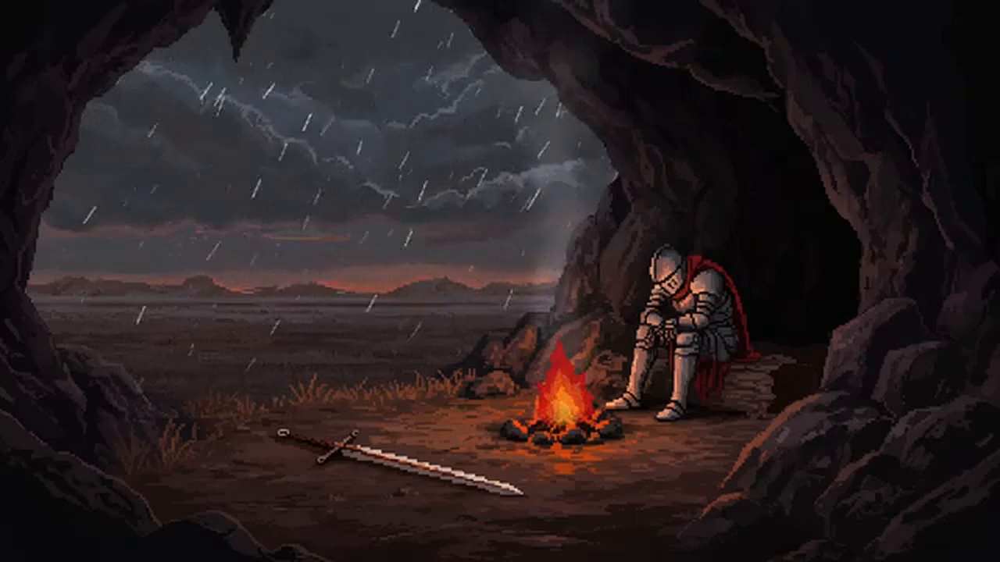

# startmenu-live-bg

Clip 15 giây làm **nền động cho Start menu Windows 11**, chạy bằng mod
[Windhawk](https://windhawk.net) `XAML-Video-Injector`.



| | |
| --- | --- |
| Nguồn | [`J0shA9J-4Nc`](https://www.youtube.com/watch?v=J0shA9J-4Nc) — *Rest... Let the storm pass*, kênh **Quest & Rest** |
| Doạn cắt | `00:01:00` → `00:01:15` (15,00 s) |
| Xuất ra | H.264, 1280×720, 24 fps, không tiếng, `+faststart`, ~2 MB |
| File | [`media/start-bg.mp4`](media/start-bg.mp4) |

## Repo này có gì

```
media/start-bg.mp4           clip 15 giay de dua vao Windhawk
scripts/make-clip.ps1        tai + cat clip (tu lo yt-dlp / ffmpeg)
scripts/install-mod.ps1      cai / go mod XAML-Video-Injector (co ban va layout)
scripts/set-startmenu-bg.ps1 chon nen Start menu: video | image | show
mod/settings.yaml            cau hinh tham khao cho tab Settings cua mod
docs/preview.png             anh xem truoc
```

`install-mod.ps1` làm đúng những gì giao diện Windhawk làm (Windhawk 1.7.3
không có CLI): tải `.wh.cpp`, compile bằng `clang++.exe` của Windhawk với đúng
tham số trong `compilerUtils.ts` (v1.7.3), copy DLL vào `Engine\Mods\64\`, ghi
cấu hình vào `HKLM\SOFTWARE\Windhawk\Engine\Mods\<id>`, rồi khởi động lại
Windhawk và Start menu.

## Yêu cầu

- Windows 11 (Start menu dùng XAML/WinUI — mod **không** chạy trên Windows 10)
- [Windhawk](https://windhawk.net) đã cài
- Mod **XAML-Video-Injector** — có trên store:
  <https://windhawk.net/mods/xaml-video-injector>
  (mã nguồn: [bbmaster123/FWFU](https://github.com/bbmaster123/FWFU),
  `Personal Windhawk Mods/XAML-Video-Injector.cpp`)

## Cài đặt

1. Clone về một đường dẫn **cố định, không dấu**:

   ```powershell
   git clone https://github.com/kh4i-dev/startmenu-live-bg.git D:\startmenu-live-bg
   ```

2. Mở **PowerShell bằng quyền admin**, cài mod (tự tải nguồn, tự vá lỗi layout,
   tự compile):

   ```powershell
   cd D:\startmenu-live-bg
   .\scripts\install-mod.ps1 -VideoPath "D:\startmenu-live-bg\media\start-bg.mp4"
   ```

3. Chuyển nền Start menu sang video (gỡ `ImageBrush` của Start Menu Styler để
   không chồng hai lớp):

   ```powershell
   .\scripts\set-startmenu-bg.ps1 -Mode video
   ```

4. Bấm phím Windows. Clip lặp phía sau các icon.

Muốn quay lại nền ảnh/GIF từ repo wallpaper:

```powershell
.\scripts\set-startmenu-bg.ps1 -Mode image
.\scripts\set-startmenu-bg.ps1 -Mode show     # xem dang dat gi
```

Hoặc cài bằng tay qua giao diện Windhawk: **Mods** → `XAML-Video-Injector` →
Install → tab **Settings** → chế độ **Textual** → dán
[`mod/settings.yaml`](mod/settings.yaml) (nhớ đổi `startMenuVideoUrl`, dùng `\\`
cho dấu `\`). Cách này **không có bản vá layout** — xem mục dưới.

> Không muốn dùng clip này? Dán URL của bạn vào `startMenuVideoUrl` — mod
> nhận cả URL trực tiếp. Hoặc chạy script bên dưới để làm clip mới.

## Tự làm lại clip

```powershell
cd D:\startmenu-live-bg
powershell -NoProfile -ExecutionPolicy Bypass -File .\scripts\make-clip.ps1 `
    -Url "https://www.youtube.com/watch?v=J0shA9J-4Nc" `
    -Start "00:01:00" -Duration 15
```

Script tự tải `yt-dlp` + `ffmpeg` nếu máy chưa có, tải **đúng đoạn cần**
(`--download-sections`) nên không phải kéo cả video 5 tiếng, rồi xuất H.264 CRF 18
kèm `unsharp` nhẹ.

### Nếu YouTube chặn (bot-check / 429)

YouTube đang bật thử nghiệm **SABR-only** cho một số IP: client `web` không trả về
link tải, chỉ còn `android` với bản 360p. Cách xử lý:

```powershell
# 1. doi client hoac them cookie trinh duyet da dang nhap YouTube
.\scripts\make-clip.ps1 -Url "<url>" -Browser firefox     # net nhat
.\scripts\make-clip.ps1 -Url "<url>" -Client default      # de yt-dlp tu chon
```

`--cookies-from-browser chrome` / `edge` **không chạy được** trên Chrome/Edge 127+
vì App-Bound Encryption — yt-dlp báo `Failed to decrypt with DPAPI`. Dùng Firefox,
hoặc export `cookies.txt` rồi thêm `--cookies`.

Bản 360p vẫn dùng tốt cho Start menu: bề ngang Start menu chỉ ~640 px, và video
được crop theo chiều dọc nên phần thừa hai bên đằng nào cũng bị cắt.

## Ghi chú kỹ thuật

- **`startMenuZIndex: -1`** — đẩy video xuống dưới lớp XAML của Start menu. Để `0`
  trở lên là video che mất icon và ô tìm kiếm.
- **`startMenuOpacity: 100`** — theme Start menu có acrylic mờ thì hạ xuống 70–85
  cho dễ đọc chữ.
- **Không tiếng** (`-an`): mod cũng mute mặc định, và âm thanh Start menu gần như
  luôn là ý tồi.
- Mod chạy trong `StartMenuExperienceHost.exe`; sau khi **Windows Update** đôi khi
  phải tắt/bật lại mod.
- Máy yếu: đặt `startMenuRate: 50` (phát 0.5×) hoặc dùng `-Width 640`.

## Gỡ mod

```powershell
# chay trong PowerShell admin
.\scripts\install-mod.ps1 -Uninstall
```

Xoá registry key, DLL, source rồi khởi động lại Windhawk. DLL còn bị
`explorer.exe` giữ trong RAM thì phải đăng xuất/đăng nhập mới xoá được (vô hại).

## Lỗi layout của mod gốc và bản vá

`XAML-Video-Injector` bản gốc làm **hỏng layout Start menu**: menu rộng ra và
tràn khỏi màn hình.

Trong `CreateAndInjectVideo()` (bản UWP — bản mà Start menu dùng) mod tạo một
`Grid` rồi chèn vào `child[0]` của root Start menu, nhưng **không đặt
`Width`/`Height`**:

```cpp
Grid videoContainer;
videoContainer.HorizontalAlignment(Stretch);
videoContainer.VerticalAlignment(Stretch);
// ... khong co Width/Height
targetGrid.Children().InsertAt(0, videoContainer);
```

`MediaPlayerElement` không có kích thước sẽ cộng **kích thước tự nhiên của video**
(ở đây 1280×720) vào `DesiredSize` của Grid cha → Grid cha phình ra → Start menu
rộng thêm rồi bị đẩy lệch và cắt cụt ở mép màn hình.

`install-mod.ps1` tự vá khi cài: ghim `Width`/`Height` của cả container lẫn
player theo `ActualWidth`/`ActualHeight` của ô chứa, và đồng bộ lại qua
`SizeChanged`. Vá chỉ áp cho bản UWP; bản WinUI3 (`CreateAndInjectVideoWinUI3`)
nằm sau và không được Start menu dùng tới, sửa vào sẽ sai namespace (`mux::`).

Bản vá được áp bằng cách chèn code vào file nguồn **tải tại chỗ** (không kèm
nguồn của tác giả trong repo này). Dùng `-NoLayoutPatch` nếu bạn muốn nguồn
nguyên bản.

## Lưu ý: mod này xung đột với nền `ImageBrush`

Nếu Start menu đã có nền kiểu
[`Windows 11 Start Menu Styler`](https://windhawk.net/mods/windows-11-start-menu-styler)
(`Background:=<ImageBrush ... ImageSource="https://..."/>`), thì hai thứ này
**chồng lên nhau**: `ImageBrush` là nền đục phủ toàn bộ `Border#AcrylicBorder`,
nên video nằm dưới không thấy được, mà `Grid` mà mod này chèn vào root của Start
menu lại làm lệch/phá layout của menu.

Chỉ nên dùng **một** trong hai:

| | `ImageBrush` (Start Menu Styler) | mod này (video) |
| --- | --- | --- |
| Cách làm | 1 style XAML trỏ tới 1 URL ảnh/GIF | chèn `MediaPlayerElement` vào cây XAML |
| Nguồn | URL công khai (raw GitHub) | file local hoặc URL |
| Tải máy | rất nhẹ, ảnh tĩnh/GIF | giải mã video liên tục |
| Rủi ro | gần như không | động vào layout Start menu |

## Bản quyền

- Clip trong `media/` cắt từ video gốc trên YouTube — **bản quyền thuộc tác giả
  video gốc**. Repo chỉ lưu cho mục đích cá nhân, không phân phối lại.
- Mod `XAML-Video-Injector` thuộc về bbmaster123 — xem repo gốc để biết giấy phép.
- Script trong repo này: MIT.
