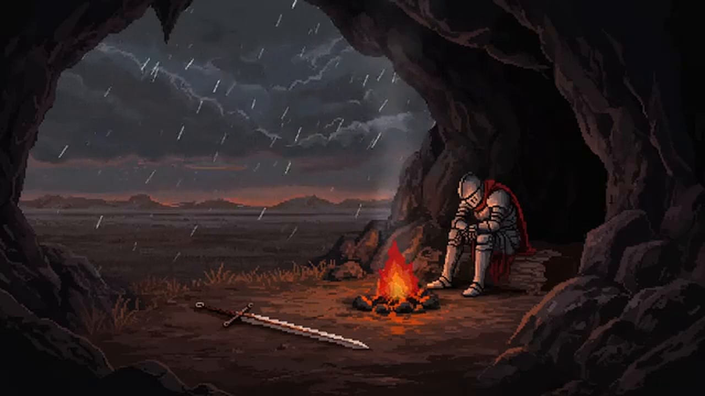

# startmenu-live-bg

**English** | [Tiếng Việt](README.vi.md)

A 15-second clip used as the **animated Windows 11 Start Menu background**, running
through the [Windhawk](https://windhawk.net) mod `XAML-Video-Injector`.



| | |
| --- | --- |
| Source | [`J0shA9J-4Nc`](https://www.youtube.com/watch?v=J0shA9J-4Nc) — *Rest... Let the storm pass*, channel **Quest & Rest** |
| Segment | `00:01:00` → `00:01:15` (15.00 s) |
| Export | H.264, 1280×720, 24 fps, no audio, `+faststart`, ~2 MB |
| File | [`media/start-bg.mp4`](media/start-bg.mp4) |

## What's in this repo

```
media/start-bg.mp4             the 15-second clip to feed into Windhawk
scripts/make-clip.ps1          download + cut a clip (wraps yt-dlp / ffmpeg)
scripts/install-mod.ps1        install / remove the XAML-Video-Injector mod (with the layout patch)
scripts/set-startmenu-bg.ps1   pick the Start menu background: video | image | show
scripts/set-startmenu-hide.ps1 hide Start menu blocks: pinned | apps | both
mod/settings.yaml              reference config for the mod's Settings tab
docs/preview.png               preview image
```

`install-mod.ps1` does exactly what the Windhawk UI does (Windhawk 1.7.3 has no CLI):
downloads the `.wh.cpp` source, compiles it with Windhawk's `clang++.exe` using the
exact flags from `compilerUtils.ts` (v1.7.3), copies the DLL into
`Engine\Mods\64\`, writes the config under
`HKLM\SOFTWARE\Windhawk\Engine\Mods\<id>`, then restarts Windhawk and the Start menu.

## Requirements

- Windows 11 (the Start menu uses XAML/WinUI — the mod does **not** work on Windows 10)
- [Windhawk](https://windhawk.net) installed
- The **XAML-Video-Injector** mod — available on the store:
  <https://windhawk.net/mods/xaml-video-injector>
  (source: [bbmaster123/FWFU](https://github.com/bbmaster123/FWFU),
  `Personal Windhawk Mods/XAML-Video-Injector.cpp`)

## Setup

1. Clone to a **fixed path without spaces or non-ASCII characters**:

   ```powershell
   git clone https://github.com/kh4i-dev/startmenu-live-bg.git D:\startmenu-live-bg
   ```

2. Open **PowerShell as admin**, install the mod (downloads the source, applies the
   layout patch, compiles — all automatic):

   ```powershell
   cd D:\startmenu-live-bg
   .\scripts\install-mod.ps1 -VideoPath "D:\startmenu-live-bg\media\start-bg.mp4"
   ```

3. Switch the Start menu background to video (this removes the Start Menu Styler
   `ImageBrush` so the two layers don't stack):

   ```powershell
   .\scripts\set-startmenu-bg.ps1 -Mode video
   ```

4. Press the Windows key. The clip now loops behind the icons.

To go back to a wallpaper image/GIF (e.g. from the wallpapers repo):

```powershell
.\scripts\set-startmenu-bg.ps1 -Mode image
.\scripts\set-startmenu-bg.ps1 -Mode show     # show what is currently set
```

Or install manually through the Windhawk UI: **Mods** → `XAML-Video-Injector` →
Install → **Settings** tab → **Textual** mode → paste
[`mod/settings.yaml`](mod/settings.yaml) (remember to change `startMenuVideoUrl`,
and use `\\` for backslashes). This way you **don't get the layout patch** — see
the section below.

> Don't want this particular clip? Paste any URL into `startMenuVideoUrl` — the mod
> accepts direct URLs too. Or use the script below to make your own clip.

## Making your own clip

```powershell
cd D:\startmenu-live-bg
powershell -NoProfile -ExecutionPolicy Bypass -File .\scripts\make-clip.ps1 `
    -Url "https://www.youtube.com/watch?v=J0shA9J-4Nc" `
    -Start "00:01:00" -Duration 15
```

The script downloads `yt-dlp` + `ffmpeg` if missing, and fetches **only the segment
you need** (`--download-sections`) so you never pull the whole 5-hour video. Output
is H.264 CRF 18 with a light `unsharp`.

### If YouTube blocks you (bot-check / 429)

YouTube is rolling out **SABR-only** for some IPs: the `web` client no longer
returns download links, leaving only `android` at 360p. Workarounds:

```powershell
# 1. switch client, or pass cookies from a logged-in browser
.\scripts\make-clip.ps1 -Url "<url>" -Browser firefox     # best quality
.\scripts\make-clip.ps1 -Url "<url>" -Client default      # let yt-dlp choose
```

`--cookies-from-browser chrome` / `edge` **does not work** on Chrome/Edge 127+
because of App-Bound Encryption — yt-dlp reports `Failed to decrypt with DPAPI`.
Use Firefox, or export a `cookies.txt` and add `--cookies`.

The 360p output is still fine for the Start menu: the menu is only ~640 px wide,
and the video gets cropped vertically anyway, so the sides are cut regardless.

## Technical notes

- **`startMenuZIndex: -1`** — pushes the video below the Start menu's XAML layer.
  `0` or higher makes the video cover the icons and the search box.
- **`startMenuOpacity: 100`** — if your Start menu theme has acrylic blur, drop to
  70–85 to keep text readable.
- **No audio** (`-an`): the mod mutes by default anyway, and Start menu audio is
  almost always a bad idea.
- The mod runs inside `StartMenuExperienceHost.exe`; after a **Windows Update** you
  sometimes have to toggle the mod off/on.
- Low-end machine: set `startMenuRate: 50` (playback at 0.5×) or use `-Width 640`.

## Uninstall

```powershell
# run in an admin PowerShell
.\scripts\install-mod.ps1 -Uninstall
```

Removes the registry key, the DLL and the source, then restarts Windhawk. If
`explorer.exe` still holds the DLL in memory you need to sign out/in before the
file can be deleted (harmless).

## Hiding parts of the Start menu

```powershell
.\scripts\set-startmenu-hide.ps1 -Preset pinned -Mode hide   # remove the Pinned section (VERIFIED)
.\scripts\set-startmenu-hide.ps1 -Preset pinned -Mode show   # restore
```

The `pinned` preset targets come straight from the source of the
`Windows 11 Start Menu Styler` mod (no guessing):

| Target | What it hides |
| --- | --- |
| `StartMenu.PinnedList` | the whole pinned-apps list |
| `Windows.UI.Xaml.Controls.TextBlock#PinnedListHeaderText` | the "Pinned" header text |

### ⚠️ Don't collapse blindly — it crashed my Start menu once

My first attempt hid the all-apps area using `Grid#AllAppsRoot`,
`GridView#AllAppsGrid`, `Grid#AllListHeading`. Result: **`StartMenuExperienceHost.exe`
crashed in a loop** and the Windows key did nothing. Event Viewer:

```
Faulting application name: StartMenuExperienceHost.exe
Faulting module name: StartMenu.dll
```

Collapsing an element the XAML engine needs throws an exception during layout, and
the process dies the moment the menu opens. That's why the `apps` preset is
**disabled** in the script.

To hide the all-apps area properly, inspect the **live XAML tree** first (e.g. with
m417z's `UWPSpy`) to find the exact `Type#Name` that exists on your build, add
**one** target, test immediately, and always keep an escape hatch ready:

```powershell
.\scripts\set-startmenu-hide.ps1 -Targets "<Type>#<Name>" -Mode hide
```

Element names **differ between Windows builds**. To look them up quickly, dump the
UTF-16 string tables of `StartDocked.dll` (package
`...StartMenuExperienceHost_cw5n1h2txyewy`) and `StartMenu.dll` (package
`MicrosoftWindows.Client.Core`) — build 25H2 contains `PinnedList`, `AllAppsRoot`,
`AllAppsGrid`, `AllAppsControl`, `CategoryControl`, `AllHeading`; any name not in
those tables simply won't match (harmless).

## Rescuing a crashed Start menu

```powershell
# run in an admin PowerShell
.\scripts\restore-startmenu.ps1 -Mode restore   # restore controlStyles from backup
.\scripts\restore-startmenu.ps1 -Mode disable   # disable the Styler mod entirely (last resort)
.\scripts\restore-startmenu.ps1 -Mode enable    # re-enable
```

Two traps the scripts already handle:

1. **Registry value names containing `[` `]`** — PowerShell treats them as
   **wildcards**, so `Remove-ItemProperty -Name 'controlStyles[7].target'` silently
   deletes nothing (`[7]` is parsed as a character class). The scripts here call the
   .NET registry API (`RegistryKey.SetValue/DeleteValue`) directly.
2. **Windhawk re-writes its settings from memory** — edit the registry while
   Windhawk is running and your changes get overwritten. Run
   `windhawk.exe -exit -wait` first, edit, then start Windhawk again.

## The upstream mod's layout bug and the patch

Stock `XAML-Video-Injector` **breaks the Start menu layout**: the menu widens and
overflows the screen.

In `CreateAndInjectVideo()` (the UWP variant — the one the Start menu uses), the
mod creates a `Grid` and inserts it at `child[0]` of the Start menu root, but
**never sets `Width`/`Height`**:

```cpp
Grid videoContainer;
videoContainer.HorizontalAlignment(Stretch);
videoContainer.VerticalAlignment(Stretch);
// ... no Width/Height
targetGrid.Children().InsertAt(0, videoContainer);
```

A `MediaPlayerElement` with no size contributes the **video's natural size** (here
1280×720) to the parent Grid's `DesiredSize` → the parent Grid inflates → the Start
menu grows wider, gets pushed off-center and clipped at the screen edge.

`install-mod.ps1` patches this automatically on install: it pins the
`Width`/`Height` of both the container and the player to the host cell's
`ActualWidth`/`ActualHeight`, and keeps them in sync via `SizeChanged`. The patch
applies only to the UWP variant; the WinUI3 variant (`CreateAndInjectVideoWinUI3`)
comes later in the file and isn't used by the Start menu — touching it would break
namespacing (`mux::`).

The patch is applied by inserting code into the **locally downloaded** source (this
repo does not include the author's source). Use `-NoLayoutPatch` if you want the
unmodified original.

## Note: this mod conflicts with `ImageBrush` backgrounds

If your Start menu already has a background set through
[`Windows 11 Start Menu Styler`](https://windhawk.net/mods/windows-11-start-menu-styler)
(`Background:=<ImageBrush ... ImageSource="https://..."/>`), the two **stack**:
the `ImageBrush` is an opaque background covering the whole `Border#AcrylicBorder`,
so the video underneath is invisible — while the `Grid` this mod inserts into the
Start menu root still breaks the menu's layout.

Use **one** of the two, not both:

| | `ImageBrush` (Start Menu Styler) | this mod (video) |
| --- | --- | --- |
| How | 1 XAML style pointing to 1 image URL | inserts a `MediaPlayerElement` into the XAML tree |
| Source | any public URL (raw GitHub) | local file or URL |
| Cost | very light, static image/GIF | continuous video decoding |
| Risk | almost none | touches the Start menu layout |

## Copyright

- The clip in `media/` is cut from a YouTube video — **copyright belongs to the
  original author**. The repo keeps it for personal use only and does not
  redistribute it.
- The `XAML-Video-Injector` mod belongs to bbmaster123 — see the original repo for
  its license.
- The scripts in this repo: MIT.
